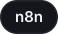

  
  
  
  

### 👋 Welcome

I’m a Presales Engineer at **AloTech / Call Center Studio**, based in Istanbul. I work on contact center projects from the first technical meeting to go-live: discovery, demos, PoCs and the integrations each customer needs. When a customer needs something the product doesn’t do yet, I connect it myself with an API, a webhook or a small automation.

- 🌏 Worked on site with customers in **Manila, Cebu and Kuala Lumpur**; demos and pilots across Türkiye, APAC, Europe and Africa
- 🎙️ Voice agents that connect telephony, IVR, CRM and knowledge bases, with a handoff to a human agent
- 🔧 Python, n8n, BigQuery and REST APIs for everything in between
- 📱 On the side: **AloPhone**, a mobile softphone with an AI assistant that helps diagnose calls

Before this, at Solution Partners, I built a pipeline that collected and cleaned 25,000+ job ads a month, and a desktop app that matched CVs to them.

### 🧰 What I work with

<!-- chips:start -->

  <picture></picture>
  <picture></picture>
  <picture></picture>
  <picture></picture>
  <picture></picture>
  <picture></picture>
  <picture></picture>
  <picture></picture>
  <picture></picture>

  <picture></picture>
  <picture></picture>
  <picture></picture>
  <picture></picture>
  <picture></picture>
  <picture></picture>
  <picture></picture>
  <picture></picture>

  <picture></picture>
  <picture></picture>
  <picture></picture>
  <picture></picture>
  <picture></picture>
  <picture></picture>
  <picture></picture>
  <picture></picture>

<!-- chips:end -->

### 🎓 Background

Mathematical Engineering at Yıldız Technical University, with an Erasmus+ year of Computer Engineering in Ireland. For my thesis I trained a deep-learning model to look for anomalies in Planck’s map of the cosmic microwave background.

Most of my work lives in private customer repos, so this is the short version. The long one is on <a href="https://erensirin.vercel.app">my website</a>.
